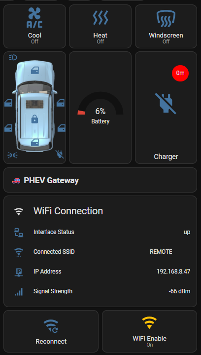
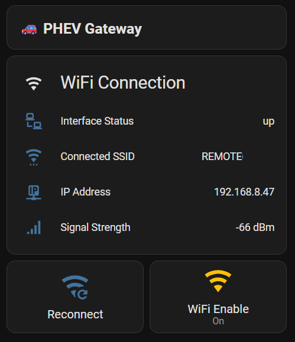

# phev2mqtt on Proxmox Debian 13

A complete guide for running [phev2mqtt](https://github.com/buxtronix/phev2mqtt) on a Debian 13 VM in Proxmox, either as a new install or migrating from a Raspberry Pi. It builds [corautem/phev2mqtt](https://github.com/corautem/phev2mqtt), a fork with connection fixes and optional extra sensors.

## What this guide covers

- Setting up the Mosquitto MQTT broker in Home Assistant, for a new install
- Creating a Debian 13 VM in Proxmox
- USB WiFi adapter passthrough (TP-Link Archer T3U Plus / RTL88x2BU)
- Installing the RTL88x2BU driver
- Connecting to the Mitsubishi Outlander PHEV WiFi hotspot
- Building and installing phev2mqtt from source
- Configuring phev2mqtt as a systemd service
- Migrating from a Raspberry Pi: stopping the old instance (skipped on a new install)
- Home Assistant MQTT integration and auto-discovery
- WiFi status sensors, reconnect button and WiFi enable/disable switch in Home Assistant
- Updating phev2mqtt with every build kept, and rolling back in one step (script or Home Assistant button)
- Optional extra car sensors: power switch, security alarm, charge type, the car's own charge and climate timers
- The car's own settings (lights, locks, wipers, A/C behaviour) shown and changed in Home Assistant, with snapshots to restore them
- Example automations: lock reminder, climate and command notifications, voice control, a charging light, gateway alerts
- Useful diagnostic commands
- Known issues and fixes

## Hardware used

- Proxmox server
- TP-Link Archer T3U Plus (AC1300) USB WiFi adapter
- Mitsubishi Outlander PHEV
- Home Assistant with Mosquitto MQTT broker

## Screenshots

## Files

| File | Description |
|---|---|
| [phev2mqtt_guide.md](./phev2mqtt_guide.md) | Complete setup guide |
| [lovelace-card.yaml](./lovelace-card.yaml) | Home Assistant Lovelace card for the PHEV Gateway dashboard |
| [configuration.yaml](./configuration.yaml) | Home Assistant MQTT sensors, switch and buttons for the gateway |
| [entities-outlander-phev-2014-2017.md](./entities-outlander-phev-2014-2017.md) | Every Home Assistant entity a 2014–2017 Outlander PHEV gets, and the vehicle settings it offers |

## Credits

- [buxtronix/phev2mqtt](https://github.com/buxtronix/phev2mqtt) — the original project this guide is based on
- [PHEV Link](https://github.com/Anwo91/phev-remote-plus) (phev-remote-plus) by Anwo91 — the register decoding, vehicle settings, commands and key resync behind the optional features of [corautem/phev2mqtt](https://github.com/corautem/phev2mqtt). They were adapted from PHEV Link's source as published on 14 October 2026, before version 1.0.92, when it was licensed under the GNU General Public License version 3 or later; the fork is under the same licence. PHEV Link has been proprietary since 15 October 2026, and nothing from its later versions is used. The fork's [Credits](https://github.com/corautem/phev2mqtt#credits) list exactly what was used. This repository holds no PHEV Link code; the vehicle setting names in [entities-outlander-phev-2014-2017.md](./entities-outlander-phev-2014-2017.md) are Mitsubishi's, as its app shows them.
- [RinCat/RTL88x2BU-Linux-Driver](https://github.com/RinCat/RTL88x2BU-Linux-Driver) — WiFi driver used in this guide
- [Claude by Anthropic](https://claude.ai) — assisted in writing and structuring this guide

## Disclaimer

This guide is provided "as is" without warranty of any kind. Follow it at your own risk. The author is not responsible for any damage to your vehicle, home automation system, or any other hardware or software. Always make sure you have backups and Proxmox snapshots before making changes.

This guide is not affiliated with or endorsed by Mitsubishi Motors, Proxmox, Home Assistant, or any other mentioned product or service.

## Licence

MIT
